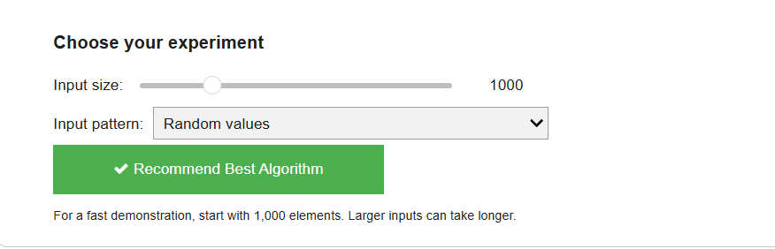
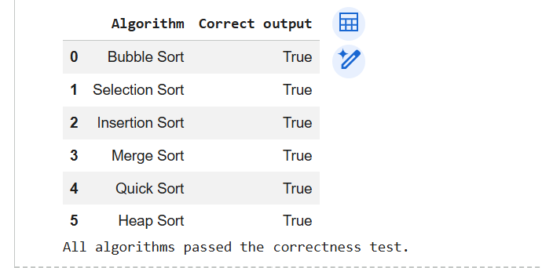

# Smart Sorting Algorithm Performance Analyzer

### Design and Analysis of Algorithms (DAA) Mini Project

## 📌 Project Overview

The Smart Sorting Algorithm Performance Analyzer is a Python-based mini project that implements and compares six sorting algorithms. Users can select the input size and input pattern, benchmark algorithm performance, and receive a recommendation based on measured execution time.

## 🎯 Objectives

- Implement six classical sorting algorithms.
- Compare their execution times across different input sizes.
- Analyze performance for different input patterns.
- Verify the correctness of the sorting algorithms.
- Recommend the fastest measured algorithm for the selected experiment.

## 🧮 Algorithms Implemented

1. Bubble Sort
2. Selection Sort
3. Insertion Sort
4. Merge Sort
5. Quick Sort
6. Heap Sort

## 🛠️ Technologies Used

- Python
- Google Colab / Jupyter Notebook
- Pandas
- Matplotlib
- ipywidgets

## ✨ Features

- Interactive input-size selection.
- Multiple input patterns: random, sorted, reverse-sorted, and nearly sorted.
- Button-based algorithm recommendation.
- Execution-time comparison table.
- Performance visualization.
- Correctness testing.
- CSV export of benchmark results.
- Theoretical time and space complexity comparison.

## 📊 Project Screenshots

### 1. Interactive Interface



### 2. Input Values and Configuration


### 3. Algorithm Performance Analysis


### 4. Algorithm Comparison



## 🚀 How to Run

1. Open the notebook in Google Colab.
2. Select **Runtime → Run all**.
3. Navigate to the interactive recommendation section.
4. Choose the input size and input pattern.
5. Click **Recommend Best Algorithm**.
6. Review the recommended algorithm, comparison table, and performance chart.

## 📈 Performance Analysis

The project measures sorting execution times and compares algorithm performance under different input conditions. Results can vary depending on the dataset, input pattern, dataset size, and runtime environment.

The fastest measured algorithm in one experiment is not necessarily the fastest for every possible input.

## 📁 Project Structure

```text
smart-sorting-algorithm-performance-analyzer/
│
├── README.md
├── Smart_Sorting_Algorithm_Performance_Analyzer.ipynb
│
└── screenshots/
    ├── README.md
    ├── Interface.png.png
    ├── Input values.png.png
    ├── Algorithm.png.png
    └── Algorithm performace analyze.png.png
```

## 🎓 Conclusion

This project demonstrates the implementation, correctness testing, benchmarking, and performance analysis of classical sorting algorithms. Its interactive recommendation feature helps users understand how input size and input patterns influence algorithm performance.

**Project Type:** Academic Mini Project  
**Subject:** Design and Analysis of Algorithms (DAA)

## Project Report

[View Project Report](Bhumi_SmartSorting_Project_Report%20(1).pdf)

